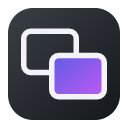
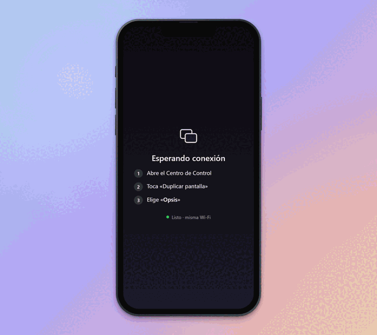
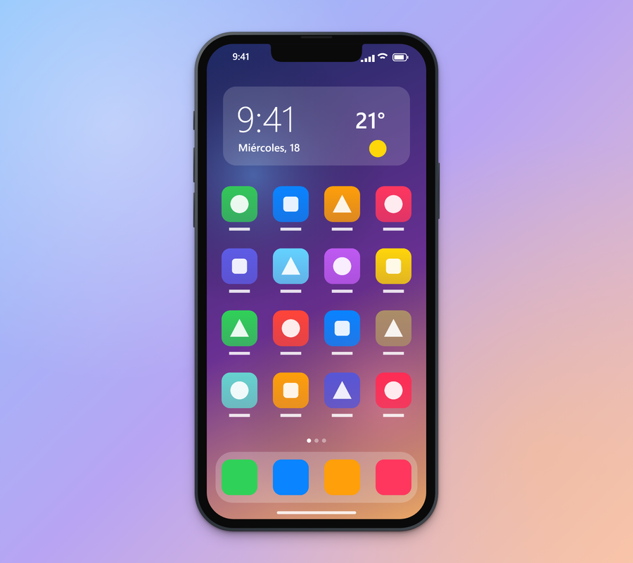
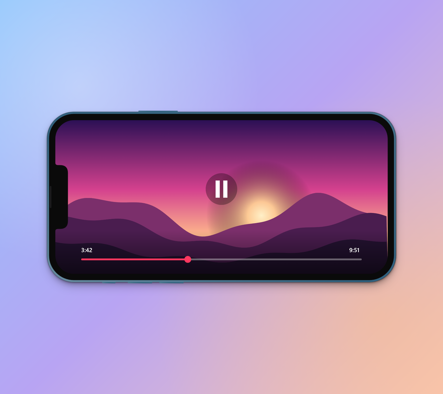

<h1> Opsis</h1>

[English](README.md) · **Español**

**Receptor AirPlay para Windows que muestra la pantalla de tu iPhone dentro de un marco de iPhone 13.**
Abre el Centro de Control en el iPhone, toca **Duplicar pantalla**, elige **Opsis** y el móvil
aparece en tu escritorio como un dispositivo sin bordes que puedes arrastrar: perfecto para demos,
clases, tutoriales o capturas para un portfolio. Las capturas y las grabaciones salen **con el marco**.

<p align="center"></p>

> El GIF usa la pantalla de demostración que trae Opsis (sin contenido de un móvil real).

*Opsis* viene del griego antiguo **ὄψις**: «vista, aspecto, lo que se ve».

## Funciones

- **Duplicar pantalla** por AirPlay, en vertical y en horizontal: el marco gira solo al girar el móvil.
- **Marco de iPhone 13** dibujado por código: muesca, botones, 6 colores y 3 tamaños (S / M / L).
- **Capturas** (PNG con fondo transparente, a 3×) en `Imágenes\Opsis` o al portapapeles.
- **Grabación** con el marco en `Vídeos\Opsis` (MP4 o WebM, de momento sin audio).
- El **audio** suena por los altavoces del PC.
- Siempre encima, se arrastra a cualquier sitio, menú con clic derecho e icono en la bandeja.
- Decodificación de vídeo por hardware (WebCodecs en WebView2).

| Vertical | Horizontal |
|---|---|
|  |  |

## Descargar y usar

1. Descarga `Opsis_x.y.z_x64-setup.exe` desde [Releases](../../releases) y ejecútalo.
   Pide permisos de administrador para crear una regla del firewall para el receptor AirPlay (solo redes privadas).
2. Abre **Opsis** desde el menú Inicio.
3. En el iPhone: **Centro de Control → Duplicar pantalla → Opsis**.

El iPhone y el PC tienen que estar en la **misma Wi-Fi**, con la red en perfil **Privado** en Windows.

> El instalador todavía no está firmado, así que SmartScreen puede avisar la primera vez:
> pulsa **Más información → Ejecutar de todas formas**.

### Atajos

| Teclas | Acción |
|---|---|
| `Ctrl + S` | Captura con marco |
| `Ctrl + Shift + S` | Captura al portapapeles |
| `Ctrl + R` | Empezar / parar grabación |
| `Ctrl + T` | Siempre encima sí/no |
| `Ctrl + 1 / 2 / 3` | Tamaño S / M / L |
| `Ctrl + G` | Cambiar el lado de la muesca (en horizontal) |
| `Esc` | Ocultar (icono de la bandeja) |

Con clic derecho sobre el móvil: tamaño, color y el resto. Al cerrar la ventana se cierra Opsis.

### Problemas típicos

| Problema | Solución |
|---|---|
| El PC no sale en «Duplicar pantalla» | Misma Wi-Fi, red en perfil **Privado**, sin red de invitados ni aislamiento de clientes |
| Sale pero no conecta | Permitir Opsis/UxPlay en el firewall en redes privadas |
| El vídeo va a tirones | Wi-Fi de 5 GHz o el PC por cable |
| La imagen se queda quieta sin desconectarse | Es normal: iOS deja de mandar imágenes si la pantalla no cambia |

## Cómo funciona

```
iPhone ──AirPlay──► uxplay.exe (sin modificar) ──RTP/H.264 por UDP 127.0.0.1──► Opsis (Tauri)
                    descubrimiento, empareja-                                   Rust: RTP → fotogramas H.264
                    miento, descifrado, audio                                   WebView2: WebCodecs → canvas + marco SVG
```

- [UxPlay](https://github.com/FDH2/UxPlay) hace lo difícil (el protocolo AirPlay) y reenvía el vídeo
  descifrado con `-vrtp`. Opsis lo lanza sin modificar, como programa aparte.
- El backend en Rust reconstruye los fotogramas H.264 a partir del RTP (RFC 6184) y se los pasa a la web.
- El marco es un SVG generado con las medidas reales del iPhone 13 (`src/frame/iphone13.ts`).

El diseño completo está en [docs/proyecto.md](docs/proyecto.md).

## Compilar

Requisitos: Windows 10/11 x64, [Rust](https://rustup.rs/) (MSVC) con Visual Studio Build Tools (C++),
Node.js LTS y [MSYS2](https://www.msys2.org/).

```bash
# 1. En una terminal MSYS2 UCRT64: compilar UxPlay y reunir sus DLLs y plugins de GStreamer
./scripts/build-uxplay.sh
./scripts/collect-runtime.sh
```

```powershell
# 2. En PowerShell
npm install
npm run tauri dev     # en desarrollo
npm run tauri build   # instalador en src-tauri\target\release\bundle\nsis
```

Para ver el marco sin iPhone: `npm run dev` y abre `http://localhost:1420/?demo`
(o `?demo=horizontal&color=azul&fondo`).

## Licencia

Opsis se publica con la [GNU GPL v3.0](LICENSE). El instalador incluye UxPlay (GPL-3.0),
GStreamer, FFmpeg y otras bibliotecas: ver [THIRD-PARTY-NOTICES.md](THIRD-PARTY-NOTICES.md).

AirPlay e iPhone son marcas de Apple Inc. Opsis es un proyecto independiente, sin relación con
Apple ni respaldado por ella. El marco es un dibujo propio; no incluye ilustraciones ni fuentes de Apple.
