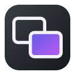
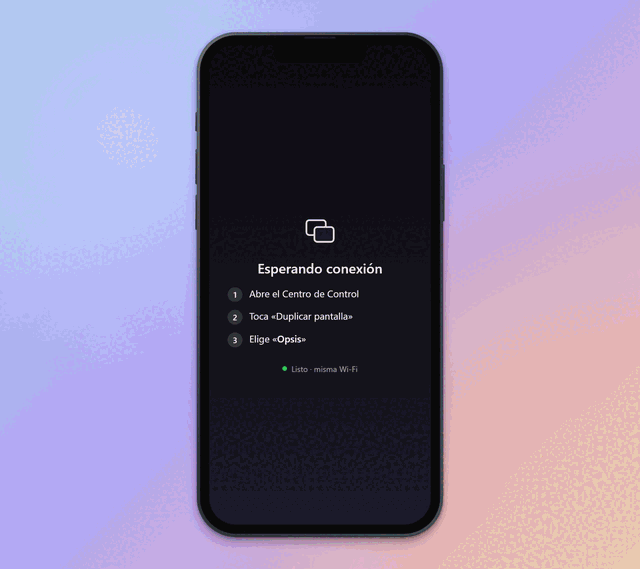
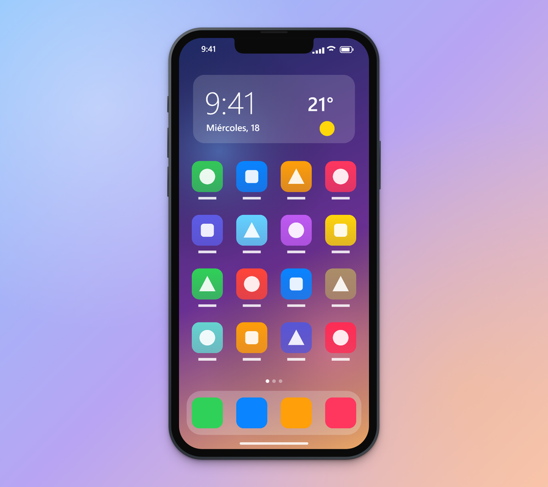
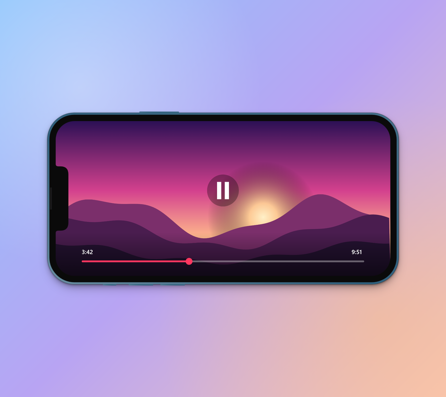

<h1> Opsis</h1>

**English** · [Español](README.es.md)

**AirPlay receiver for Windows that shows your iPhone screen inside an iPhone 13 frame.**
Open Control Center on the iPhone, tap **Screen Mirroring**, pick **Opsis**, and the phone
appears on your desktop as a borderless, draggable device, ready for demos, classes, tutorials
or portfolio screenshots. Screenshots and recordings come out **with the frame**.

<p align="center"></p>

> The GIF uses Opsis's built-in demo screen (no real phone content).

*Opsis* comes from Ancient Greek **ὄψις**, "sight, appearance, what is seen".

## Features

- **Screen mirroring** over AirPlay, portrait and landscape: the frame rotates by itself when you turn the phone.
- **iPhone 13 frame** drawn in code: notch, buttons, 6 colours and 3 sizes (S / M / L).
- **Screenshots** (PNG with transparent background, 3×) to `Pictures\Opsis` or the clipboard.
- **Recording** with the frame to `Videos\Opsis` (MP4 or WebM, no audio yet).
- **Audio** plays through the PC speakers.
- Always on top, drag it anywhere, right-click menu and tray icon.
- Hardware video decoding (WebCodecs in WebView2).

| Portrait | Landscape |
|---|---|
|  |  |

## Download and use

1. Download `Opsis_x.y.z_x64-setup.exe` from [Releases](../../releases) and run it.
   It asks for administrator rights to add a firewall rule for the AirPlay receiver (private networks only).
2. Open **Opsis** from the Start menu.
3. On the iPhone: **Control Center → Screen Mirroring → Opsis**.

The iPhone and the PC must be on the **same Wi-Fi**, with the network set to **Private** in Windows.

> The installer is not code-signed yet, so SmartScreen may warn the first time:
> click **More info → Run anyway**.

### Shortcuts

| Keys | Action |
|---|---|
| `Ctrl + S` | Screenshot with frame |
| `Ctrl + Shift + S` | Screenshot to clipboard |
| `Ctrl + R` | Start / stop recording |
| `Ctrl + T` | Always on top on/off |
| `Ctrl + 1 / 2 / 3` | Size S / M / L |
| `Ctrl + G` | Switch notch side (landscape) |
| `Esc` | Hide (tray icon) |

Right-click the phone for size, colour and the rest. Closing the window quits Opsis.

### Troubleshooting

| Problem | Fix |
|---|---|
| The PC does not appear in Screen Mirroring | Same Wi-Fi, network profile **Private**, no guest network / client isolation |
| It appears but does not connect | Allow Opsis/UxPlay in the firewall on private networks |
| Choppy video | Use 5 GHz Wi-Fi or connect the PC by cable |
| The picture freezes without disconnecting | Normal: iOS stops sending frames while the screen does not change |

## How it works

```
iPhone ──AirPlay──► uxplay.exe (unmodified) ──RTP/H.264 over UDP 127.0.0.1──► Opsis (Tauri)
                    discovery, pairing,                                       Rust: RTP → H.264 frames
                    decryption, audio                                         WebView2: WebCodecs → canvas + SVG frame
```

- [UxPlay](https://github.com/FDH2/UxPlay) does the hard part (AirPlay protocol) and forwards the
  decrypted video with `-vrtp`. Opsis runs it unmodified as a separate program.
- The Rust backend rebuilds H.264 frames from RTP (RFC 6184) and streams them to the web view.
- The frame is an SVG generated from real iPhone 13 dimensions (`src/frame/iphone13.ts`).

The full design (in Spanish) is in [docs/proyecto.md](docs/proyecto.md).

## Build from source

Requirements: Windows 10/11 x64, [Rust](https://rustup.rs/) (MSVC) with Visual Studio Build Tools (C++),
Node.js LTS and [MSYS2](https://www.msys2.org/).

```bash
# 1. In an MSYS2 UCRT64 terminal: build UxPlay and collect its DLLs and GStreamer plugins
./scripts/build-uxplay.sh
./scripts/collect-runtime.sh
```

```powershell
# 2. In PowerShell
npm install
npm run tauri dev     # run in development
npm run tauri build   # installer in src-tauri\target\release\bundle\nsis
```

To preview the frame without an iPhone: `npm run dev` and open `http://localhost:1420/?demo`
(or `?demo=horizontal&color=azul&fondo`).

## License

Opsis is released under the [GNU GPL v3.0](LICENSE). The installer bundles UxPlay (GPL-3.0),
GStreamer, FFmpeg and other libraries: see [THIRD-PARTY-NOTICES.md](THIRD-PARTY-NOTICES.md).

AirPlay and iPhone are trademarks of Apple Inc. Opsis is an independent project, not affiliated
with or endorsed by Apple. The device frame is an original drawing; no Apple artwork or fonts are included.
